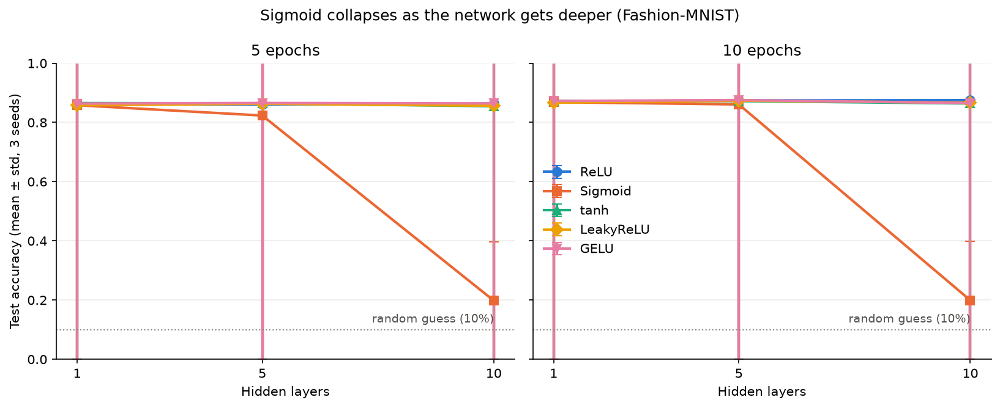
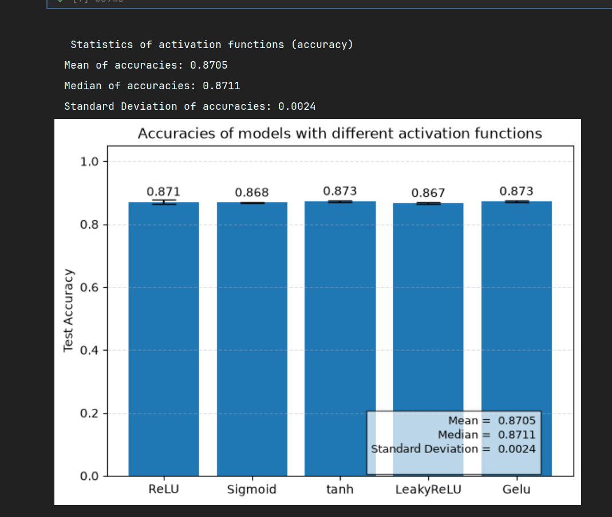
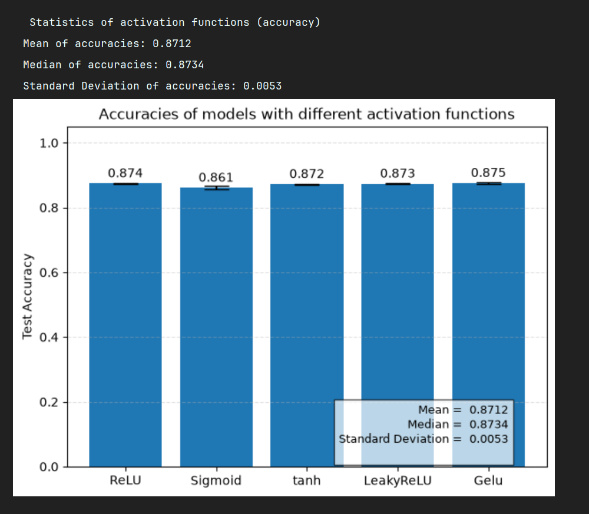
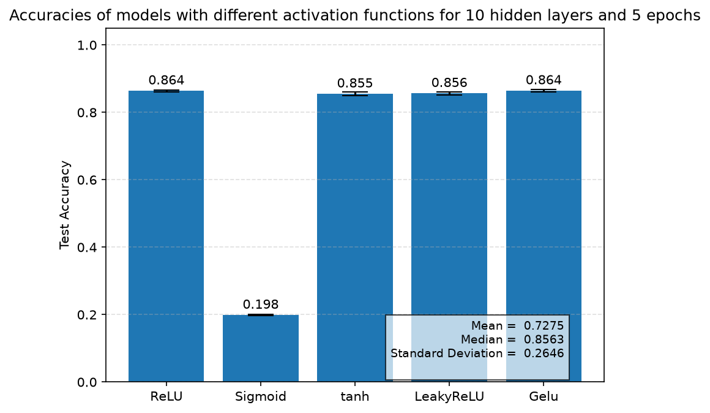

# Activation Functions in Deep Networks: Why Sigmoid Collapses

This project compares five activation functions (ReLU, Sigmoid, tanh, LeakyReLU and GELU) on the
Fashion-MNIST dataset, using networks with 1, 5 and 10 hidden layers evaluated after 5 and 10 epochs.
Each configuration is trained with 3 random seeds (15 models per depth, 45 in total).
As the network gets deeper, the accuracy of Sigmoid collapses from about 86% to 20%,
while the other four functions stay at around 86–87%.

## Key findings
1. **With a single hidden layer, the choice of activation function barely matters.** All five functions
   reach similar test accuracy (86–87%) after both 5 and 10 epochs.
2. **At 5 hidden layers, Sigmoid learns slower.** After 5 epochs it reaches 82.3% while the others
   are at about 86%, but it largely catches up after 10 epochs (86.1% vs. 87.2–87.5%).
3. **At 10 hidden layers, Sigmoid collapses.** Its test accuracy stays at 19.9% even after 10 epochs,
   while ReLU reaches 87.5%. Its cross-entropy loss starts at about 2.3, which is ln(10): the loss of
   a model that gives each of the 10 classes the same 10% probability by a random guess. After 10
   epochs it is still stuck around 1.70 (ReLU: 0.27), and its training accuracy is also about 20%,
   so the model is not overfitting; it simply cannot learn.
4. **tanh is just slightly affected.** Like Sigmoid it saturates, but it loses only about 1 percentage point
   between 1 and 10 hidden layers, while ReLU, LeakyReLU and GELU stay flat.

## Setup
| | |
|---|---|
| Dataset | Fashion-MNIST: 50,000 training / 10,000 test images, 28×28 grayscale, 10 classes |
| Model | Flatten → *N* × Dense(128) → Dense(10) |
| Hidden layers (*N*) | 1, 5, 10 |
| Activations | ReLU, Sigmoid, tanh, LeakyReLU, GELU |
| Optimizer / loss | Adam / sparse categorical cross-entropy |
| Batch size | 128 |
| Epochs | 10 (test accuracy recorded after epoch 5 and epoch 10) |
| Seeds | 1, 2, 3 (every result is mean ± std over 3 runs) |
| Environment | Python 3.12, TensorFlow 2.21, CPU |

## Results
Test accuracy, mean ± std over 3 seeds.

**After 5 epochs**
| Activation | 1 layer | 5 layers | 10 layers |
|---|---|---|---|
| ReLU | 0.861 ± 0.002 | 0.861 ± 0.000 | 0.864 ± 0.003 |
| Sigmoid | 0.858 ± 0.001 | 0.823 ± 0.003 | **0.198 ± 0.002** |
| tanh | 0.865 ± 0.004 | 0.864 ± 0.006 | 0.855 ± 0.005 |
| LeakyReLU | 0.858 ± 0.001 | 0.863 ± 0.008 | 0.856 ± 0.004 |
| GELU | 0.864 ± 0.002 | 0.866 ± 0.005 | 0.864 ± 0.004 |

**After 10 epochs**
| Activation | 1 layer | 5 layers | 10 layers |
|---|---|---|---|
| ReLU | 0.871 ± 0.006 | 0.874 ± 0.002 | 0.875 ± 0.001 |
| Sigmoid | 0.869 ± 0.001 | 0.861 ± 0.005 | **0.199 ± 0.000** |
| tanh | 0.873 ± 0.003 | 0.872 ± 0.002 | 0.864 ± 0.004 |
| LeakyReLU | 0.867 ± 0.002 | 0.873 ± 0.001 | 0.867 ± 0.005 |
| GELU | 0.873 ± 0.003 | 0.875 ± 0.003 | 0.865 ± 0.001 |

### Closer look: 10 hidden layers, 10 epochs

| Activation | Seed 1 | Seed 2 | Seed 3 | Mean ± std |
|---|---|---|---|---|
| ReLU | 0.8742 | 0.8762 | 0.8748 | 0.875 ± 0.001 |
| Sigmoid | 0.1994 | 0.1997 | 0.1989 | 0.199 ± 0.000 |
| tanh | 0.8598 | 0.8652 | 0.8671 | 0.864 ± 0.004 |
| LeakyReLU | 0.8653 | 0.8723 | 0.8629 | 0.867 ± 0.005 |
| GELU | 0.8657 | 0.8643 | 0.8658 | 0.865 ± 0.001 |

Sigmoid's loss only falls from about 2.3 to 1.7 and then stops improving, so its accuracy stays
around 20%. Its training accuracy is also about 20%, which rules out overfitting: the Sigmoid
networks cannot learn even the training data.

## Why does sigmoid collapse?
During backpropagation, the gradient is multiplied by the derivative of the activation function
at every layer. Sigmoid's derivative is at most 0.25, so after 10 layers the gradient that reaches
the first layers is at most 0.25^10 ≈ 10^-6 of its original size: the vanishing gradient problem.
Those layers barely update, so the network cannot learn.

tanh's derivative reaches up to 1 and ReLU's derivative is exactly 1 for positive inputs, so their
gradients shrink much less from layer to layer. This is why tanh is only slightly affected and the
ReLU family is not affected at all.

Hyperbolic Tangent's derivative increases up to 1, and Rectified Linear Unit's deritative in the positive axis is exactly 1.

## Reproducibility
Every model is built right after calling `keras.utils.set_random_seed(seed)` with seed 1, 2 or 3.
This fixes the random number generators of Python, NumPy and TensorFlow at once, so the initial
weights and the order in which the training data is shuffled are the same every time a
configuration is run.

To verify this, two configurations were trained again on a different day:

| Configuration | Original run | Re-run | Result |
|---|---|---|---|
| 5 hidden layers, first 5 epochs | `fmnist_5layers_5epochs_oldrun.csv` | `fmnist_5layers_10epochs.csv` | all 75 per-epoch training values and all 15 test accuracies identical |
| 10 hidden layers, 10 epochs | `fmnist_10layers_10epochs_oldrun.csv` | `fmnist_10layers_10epochs.csv` | all 150 per-epoch values identical |

The 10-layer re-run also used a rewritten model definition (hidden layers created in a loop
instead of written out by hand), which confirms that the new code builds exactly the same network.
The original runs are kept in `results/raw/` (files ending in `_oldrun`) so the comparison can be
checked by anyone.

Results were produced on CPU with TensorFlow 2.21; other hardware (e.g. a GPU) or other library
versions may give slightly different numbers.
To reproduce: install `tensorflow`, `matplotlib` and `pandas`, set `n_layers` and `n_epochs`
in the training cell of `Activation Function Comparison.ipynb`, and run all cells.

## Repository structure
- `Activation Function Comparison.ipynb`: training and per-experiment plots
- `results/raw/`: per-epoch logs of every run (CSV)
- `results/summary.csv`: mean ± std for every configuration
- `figures/`: all plots
- `tools/`: scripts that convert training logs to CSV and build the summary table

## Limitations and next steps
**Limitations**
- Only one dataset (Fashion-MNIST) was used.
- Only fully connected (dense) networks were tested.
- The test set was also used to monitor accuracy after every epoch, but no setting was chosen based on it.
- All runs were on CPU.

**Next steps**
- Repeat the experiment on CIFAR-10 to check whether the results hold on a harder dataset.
- Test whether Batch Normalization lets deep Sigmoid networks learn.

All per-experiment plots

